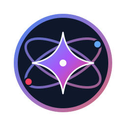

<div align="center">



# Gemini Omni MCP v2.0

**Hepsi Bir Arada Google GenAI Multimodal, Decisions & Canlı Dokümantasyon MCP Sunucusu**

*Canlı Docs Puller · Gemini 4 (`Carbon`, `Neon`, `Hydrogen`) · Decisions API (`gemini-decision-1`) · Deep Research · Multimodal Embeddings · Nano Banana 2.1 · Gemini Omni 1.2 Flash Video · Transcribe STT & İfadeli TTS · Lyria 3.5 Müzik · Gerçek Zamanlı USD Bütçe Kilidi*

[English](README.md) | **Türkçe**

[](https://www.python.org/downloads/)
[](https://modelcontextprotocol.io/)
[](https://github.com/googleapis/python-genai)
[](LICENSE)

</div>

---

## Neden Ayrı CLI Yerine MCP?

Editörün yanında harici bir CLI uygulaması açmak sürekli pencere değiştirmek, güncel olmayan eğitim verisiyle boğuşmak ve çıktıları elle projeye taşımak demektir.

**`gemini-omni-mcp` v2.0, Google'ın Kasım 2026 GenAI ekosistemini *ve* sıfır maliyetli Canlı Dokümantasyon Çekicisini (Live Docs Puller) doğrudan mevcut AI agent'ının içine (Antigravity, Claude Code, Cursor, Codex, VS Code, Claude Desktop) gömer:**

| Özellik | Ayrı CLI Penceresi | `gemini-omni-mcp` v2.0 |
| --- | --- | --- |
| **Canlı Resmi Dokümanlar** | Tarayıcı sekmesi veya ek MCP kurulumu gerekir | Dahili `gemini_search_docs` + `gemini_fetch_doc` (`gemini-api-docs-mcp.dev` + `llms.txt` yedekli) |
| **Gemini 4 Ailesi & Swarm** | Tek seferde tek sohbet istemi | `gemini-4-carbon`, `gemini-4-neon`, `gemini-4-hydrogen` + aynı anda **64 paralel asenkron işçi** |
| **Sıfır Token'lı Karar Motoru** | Yavaş metin üretimi + kırılgan JSON ayrıştırma | `gemini_decide` (`client.decisions.create`) ile tek seferde 1.000 `noul`/`choice`/`score` sorusu (0 çıktı token'ı) |
| **Multimodal Dosya Üretimi** | Çıktıları elle kopyalama | PNG, MP4, WAV/MP3, Markdown raporları, contact sheet ve vektörleri doğrudan projeye yazar |
| **Maliyet Güvenliği** | Otomatik USD harcama kesicisi yok | Canlı harcama defteri + otomatik `OMNI_HARD_STOP_LIMIT_USD` bütçe kilidi |

---

## Araç Matrisi (16 Araç: 13 Çekirdek + 3 Opsiyonel 3D/CAD)

### Çekirdek Araçlar (Her Zaman Aktif)

| Kategori | Araç | Model(ler) / Kaynak | Yetenekler |
| --- | --- | --- | --- |
| **Canlı Docs** | `gemini_search_docs` | `gemini-api-docs-mcp.dev` + `llms.txt` | Resmi Gemini API ve SDK dokümanlarını `language`, `scope`, `source`, `api` filtreleriyle canlı arar (\$0.00) |
| **Canlı Docs** | `gemini_fetch_doc` | `gemini-api-docs-mcp.dev` + `aistudio.google.com` | `chunk_id` parçalarını veya izinli HTTPS `.md` doküman sayfalarını temiz Markdown olarak çeker (\$0.00) |
| **Decisions** | `gemini_decide` | `gemini-decision-1` | Metin, PDF, ses, görsel ve video üzerinde tek ileri geçişle `noul` (evet/hayır), `choice` ve `score` olasılıkları (0 çıktı token'ı) |
| **Agents** | `gemini_deep_research` | `deep-research-preview-04-2026`, `deep-research-max-preview-04-2026`, `antigravity-preview-09-2026` | Interactions API üzerinden arka planda otonom çok adımlı araştırma başlatır, izler ve Markdown raporu kaydeder |
| **Embeddings** | `gemini_embed` | `gemini-embedding-2` | Metin, görsel, ses, video ve PDF için birleşik multimodal vektörler + ikili kosinüs benzerlik matrisi |
| **Görsel** | `gemini_image_fusion` | `gemini-nano-banana-2.1`, `gemini-3.1-flash-image`, `gemini-3-pro-image` | 14 adede kadar referans + stil çıpası birleştirme, karakter/mimari/sprite ön ayarları, `0.5K`–`4K` `ImageConfig` |
| **Görsel** | `gemini_image_edit` | `gemini-nano-banana-2.1` | Bölgesel düzenleme, maskeli `inpaint`/`outpaint` ve `2x`/`4x` AI yükseltme (Lanczos yedekli; kapatılan Imagen'in yerini alır) |
| **Video** | `gemini_video_studio` | `gemini-omni-1.2-flash`, `gemini-omni-1.1-flash` | `3s`–`15s` video üretimi, `extend`, `edit`, `seamless_loop`, kareler arası geçiş, `1080p`/`4k` için otomatik URI indirme |
| **Ses & Müzik** | `gemini_audio_studio` | `gemini-3.8-flash-tts`, `gemini-3.5-transcribe`, `lyria-3.5` | İfadeli TTS (`speech_metadata`), konuşma deşifresi (`verbatim`, konuşmacı ayrımı, kelime zaman damgası, `smart`, `custom_vocabulary`), Voices API ve Lyria 3.5 müzik |
| **Önbellek** | `gemini_context_cache` | `gemini-4-carbon`, `gemini-4-hydrogen`, Gemini 3.x | Gemini 4 için deterministik implicit önbellek demeti (%95 indirim) + 3.x modelleri için açık `client.caches.create` |
| **Swarm** | `gemini_async_swarm` | `gemini-4-hydrogen`, `gemini-4-neon`, `gemini-4-carbon` | `thinking_level` (`minimal`..`xhigh`), Code Execution, Google Search ve JSON Schema ile 64 paralel asenkron işçi |
| **Görsel QA** | `gemini_curate_refs` | `gemini-4-hydrogen` | Numaralı Pillow JPEG contact sheet oluşturur ve en net `top_k` referansı tek seferde seçer |
| **FinOps** | `gemini_cost_and_budget` | Çevrimdışı FinOps Motoru | Canlı `summary`, 24 modelli `pricing_table`, `calculate_call`, `estimate_batch`, `set_budget_limit`, `reset_ledger` |

### Opsiyonel 3D / CAD RLAIF Paketi (Varsayılan Açık; İsteğe Bağlı Kapatılabilir)

Yalnızca **13 çekirdek araçla** hafif modda çalıştırmak için `GEMINI_OMNI_ENABLE_3D_TOOLS=false` ayarlayın veya `--no-3d-tools` kullanın.

| Araç | Birincil Model(ler) | Yetenekler |
| --- | --- | --- |
| `vision_extract_3d_spec` | `gemini-4-hydrogen` + PIL | Piksel medyanı HEX örnekleme + yapısal PBR malzeme paleti, 3D oranlar ve üçgen bütçesi spesifikasyonu |
| `vision_rlaif_3d_critic` | `gemini-4-hydrogen` | Çok açılı 3D render'ları referanslar ve `spec_rules` ile kıyaslayarak koordinat/mesh düzeltmeleri üretir |
| `gemini_3d_judge_and_autopatch` | `gemini-4-carbon` + `gemini-4-hydrogen` | Üst düzey 3D görsel ve kod denetçisi; `.py` scriptlerini `ast.parse` kontrolüyle yamalar, Blender/özel render çalıştırır, hatada geri sarar ve 5 denemede devreyi keser |

---

## Canlı Docs Puller & Resmi Google Agent Kurulumu

`gemini-omni-mcp`, canlı dokümantasyon arama (`gemini_search_docs`) ve sayfa çekme (`gemini_fetch_doc`) araçlarını **API anahtarı gerektirmeden** ve `https://aistudio.google.com/llms.txt` yedeğiyle birlikte doğrudan MCP sunucusunun içine entegre eder.

İsterseniz Google'ın bağımsız resmi araçlarını da yanına kurabilirsiniz:

```bash
# Bağımsız resmi Gemini Docs MCP sunucusu
npx add-mcp "https://gemini-api-docs-mcp.dev"

# Resmi Gemini API agent yetenekleri (güncel SDK sözdizimi ve kurallar)
npx skills add google-gemini/gemini-skills --skill gemini-api-dev

# Antigravity'de tek komutla eklenti kurulumu
agy plugin install https://github.com/google-gemini/gemini-skills

# Terminalden doğrudan Gemini API çağıran bağımsız Go CLI
curl -fsSL https://raw.githubusercontent.com/google-gemini/gemini-api-cli/main/scripts/install.sh | bash
```

---

## Hızlı Kurulum & İstemci Bağlantısı

### Gereksinimler
- Python **3.11+** (veya [`uv`](https://docs.astral.sh/uv/))
- `google-genai>=3.2.0` (`uv` veya `pip` ile otomatik kurulur)
- Üretim çağrıları için `GEMINI_API_KEY` (veya `GOOGLE_API_KEY`) — Docs Puller anahtarsız da çalışır

### Seçenek A: `uvx` / `uv` ile Sıfır Kurulum (Önerilen)

```bash
# Doğrudan GitHub üzerinden uvx ile çalıştır
uvx --from git+https://github.com/Remilya/gemini-omni-mcp gemini-omni-mcp

# Veya yerel klondan çalıştır
git clone https://github.com/Remilya/gemini-omni-mcp.git
cd gemini-omni-mcp
uv run gemini-omni-mcp --list-tools
```

### Seçenek B: `pip` ile Kurulum

```bash
pip install git+https://github.com/Remilya/gemini-omni-mcp.git
gemini-omni-mcp --version
```

<details open>
<summary><strong>Antigravity / Claude Code / Cursor / Codex / VS Code Örnekleri</strong></summary>

```json
{
  "mcpServers": {
    "gemini-omni": {
      "command": "uvx",
      "args": [
        "--from",
        "git+https://github.com/Remilya/gemini-omni-mcp",
        "gemini-omni-mcp"
      ],
      "env": {
        "GEMINI_API_KEY": "GEMINI_API_ANAHTARINIZ",
        "OMNI_HARD_STOP_LIMIT_USD": "50.0",
        "GEMINI_OMNI_ENABLE_3D_TOOLS": "true"
      }
    }
  }
}
```

Claude Code CLI:
```bash
claude mcp add gemini-omni \
  -e GEMINI_API_KEY="GEMINI_API_ANAHTARINIZ" \
  -e OMNI_HARD_STOP_LIMIT_USD="50.0" \
  -- uvx --from git+https://github.com/Remilya/gemini-omni-mcp gemini-omni-mcp
```

</details>

---

## Gerçek Zamanlı USD Harcama Takibi & Bütçe Kilidi

Tüm token, görsel, video, ses ve önbellek kullanımları `<workspace>/.gemini-omni/usage_ledger.json` dosyasına yazılır:

- **Varsayılan limit:** `$50.00 USD` (`OMNI_HARD_STOP_LIMIT_USD=50.0`)
- **Otomatik devre kesici:** Limit aşıldığında defter kilitlenir, bellek içi API anahtarları silinir ve `HardBudgetStopError` fırlatılır.
- **Araç komutları:** `summary`, `estimate_batch`, `set_budget_limit` (`0` verilirse kilidi kapatır), `reset_ledger`.

---

## Geliştirme & Testler

```bash
git clone https://github.com/Remilya/gemini-omni-mcp.git
cd gemini-omni-mcp
uv sync --extra dev

# Çevrimdışı birim testleri (API anahtarı gerekmez)
uv run --extra dev pytest -v

# Kayıtlı araçları kontrol et
uv run gemini-omni-mcp --list-tools
```

---

## Lisans

MIT Lisansı — [LICENSE](LICENSE).
